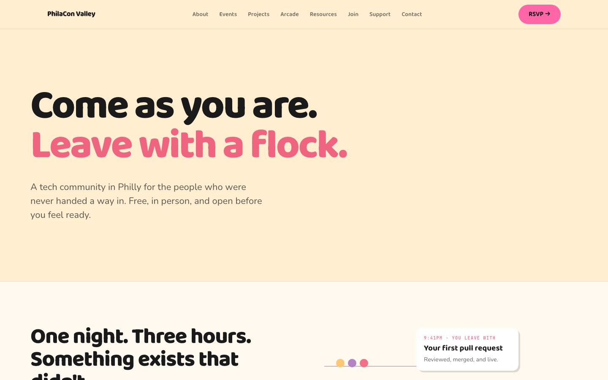

# PhilaCon Valley Website

[](https://opensource.org/licenses/MIT)
[](https://github.com/philaconvalley/website/actions/workflows/ci.yml)
[](CONTRIBUTING.md)

The official website for **PhilaCon Valley** — Philadelphia's tech community by us, for us.

**Live Site**: [philaconvalley.com](https://philaconvalley.com) | **Events**: [lu.ma/philaconvalley](https://lu.ma/philaconvalley) | **Donate**: [Open Collective](https://opencollective.com/philacon-valley)

Built with [Astro](https://astro.build), [Tailwind CSS](https://tailwindcss.com), and [Alpine.js](https://alpinejs.dev), hosted on [Vercel](https://vercel.com). See [Architecture](docs/architecture.md) for the full breakdown. The design follows the PhilaCon Valley Brand Identity Guidebook, Edition 1.2. See [DESIGN.md](DESIGN.md) for the rules.

<!-- Captured October 19, 2026 from the live site at 1440x900 with reduced motion, right after
     the Brand Book 1.2 redesign went live. The hero photo is random per visit, so the capture
     pins it to the first one (Math.random = 0). Retake it when the homepage hero or the nav changes. -->



---

## What's on the site

| Page                                              | What it holds                                             |
| ------------------------------------------------- | --------------------------------------------------------- |
| [Home](https://philaconvalley.com)                | The next event, how a night goes, photos from past nights |
| [About](https://philaconvalley.com/about)         | Why PhilaCon Valley exists, in the founder's words        |
| [Events](https://philaconvalley.com/events)       | The calendar, the kinds of nights we run, and recaps      |
| [Projects](https://philaconvalley.com/projects)   | Open-source community projects and good first issues      |
| [Arcade](https://philaconvalley.com/arcade)       | Browser games built by the community                      |
| [Resources](https://philaconvalley.com/resources) | Free tutorials and walkthroughs                           |
| [Join](https://philaconvalley.com/join)           | Discord, and how to come to a free Lab                    |
| [Support](https://philaconvalley.com/support)     | Donate, sponsor, mentor, or host a night                  |
| [Contact](https://philaconvalley.com/contact)     | One inbox for questions and ideas                         |

Some sections are in the code but stay hidden. An entry with `status: draft` does not build, and a section with no approved entries does not show.

---

## Quick start

You need [Node.js](https://nodejs.org) 22.12 or newer. [Fork the repo](https://github.com/philaconvalley/website/fork) first, then run:

```bash
git clone https://github.com/YOUR-USERNAME/website.git
cd website
npm install
npm run dev
```

Open http://localhost:4321. The full walkthrough, with fixes for common errors, is in [Getting Started](docs/getting-started.md).

### Before you open a pull request

CI runs these checks on every pull request into `main`. Run them on your computer first:

```bash
npm run lint
npm run format:check
npm run build                                # also runs astro check
npx playwright install --with-deps chromium  # once, for the e2e tests
npm run test:e2e
```

### Your first contribution

Pick an issue labeled [good first issue](https://github.com/philaconvalley/website/issues?q=is%3Aissue+is%3Aopen+label%3A%22good+first+issue%22). The maintainers pick these for a first pull request. Then follow the [Contributing Guide](docs/contributing.md).

---

## Who is this for?

Whether you're a first-time contributor, a seasoned developer, a designer, a writer, or someone who just wants to help — there's a place for you here.

| I want to...                               | Start here                                                                                 |
| ------------------------------------------ | ------------------------------------------------------------------------------------------ |
| Report a bug or suggest a feature          | [Open an issue](https://github.com/philaconvalley/website/issues/new/choose)               |
| Add a project or resource (no code needed) | [Adding Content](docs/adding-content.md)                                                   |
| Set up the site on my computer             | [Getting Started](docs/getting-started.md)                                                 |
| Contribute code                            | [Contributing Guide](docs/contributing.md)                                                 |
| Find a small first task                    | [Good first issues](https://github.com/philaconvalley/website/labels/good%20first%20issue) |
| Understand how the site is built           | [Architecture](docs/architecture.md)                                                       |
| Work with the brand colors and design      | [Design System](docs/design-system.md)                                                     |
| Understand the design rules and motion     | [DESIGN.md](DESIGN.md)                                                                     |
| Understand who the site serves             | [PRODUCT.md](PRODUCT.md)                                                                   |
| Write a blog post or share my content      | [Writing Guide](docs/writing-guide.md)                                                     |

---

## What is PhilaCon Valley?

A community-driven tech org centering Black, Brown, LGBTQIA+, and underrepresented folks in tech. We build together through Labs, workshops, career support, and open source projects like this website.

---

## Connect With Us

[Events](https://lu.ma/philaconvalley) | [Discord](https://discord.gg/5haHYh5xcx) | [Instagram](https://www.instagram.com/phlconvalley/) | [LinkedIn](https://www.linkedin.com/company/philaconvalley/) | [Twitter/X](https://x.com/PhlConValley) | [GitHub](https://github.com/philaconvalley) | support@philaconvalley.com

Please read our [Code of Conduct](./CODE_OF_CONDUCT.md) before participating.

Found a security problem? Do not open a public issue. Follow [SECURITY.md](./SECURITY.md) to report it privately.

---

## Support Us

Help us keep PhilaCon Valley free and accessible: [Donate](https://opencollective.com/philacon-valley) | [Sponsor an Event](mailto:support@philaconvalley.com) | [Lead a Workshop](mailto:support@philaconvalley.com) | [Provide Venue Space](mailto:support@philaconvalley.com)

---

**MIT Licensed** — you can use, modify, and share this code freely. See [LICENSE](./LICENSE).

**Built with love in Philadelphia** — Making Philly the tech hub it's meant to be: by us, for us.
